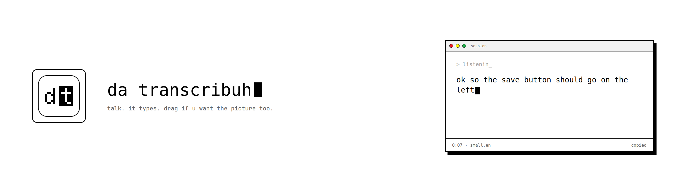
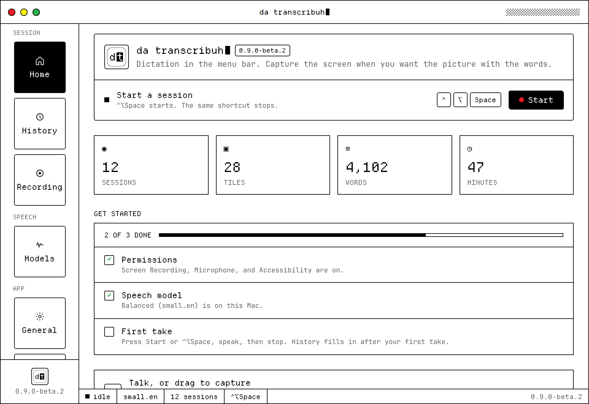

<p align="center">
  <picture>
    <source media="(prefers-color-scheme: dark)" srcset="assets/brand/wordmark-g-dt-block-dark.png">
    
  </picture>
</p>

<p align="center">
  
</p>

<p align="center">dictation in ur menu bar. grab the screen when u want the picture with the words.</p>

<p align="center">
  <a href="https://github.com/bicrick/da-transcribuh/releases/latest">download</a>
  ·
  <a href="#install">build from source</a>
  ·
  <a href="LICENSE">MIT</a>
  ·
  macOS 14+
</p>

<!-- TODO: drop a short demo gif at assets/demo.gif (talk, drag, paste) and embed it here when ready -->

## look

black and white chrome with a tiny bit of classic ms paint. departure mono for labels and chrome, sf mono for longer copy. custom scroll bars. system / light / dark from general (or cycle `theme: …` in the menu bar). the recording island, waveform, and annotate toolbar match the same ink — not a leftover overlay.

paint shows up only where it helps: traffic-light dots when the window is key (`#ED1C24` / `#FFF200` / `#22B14C`), the record mark, and a green check when something’s actually done.

<p align="center">
  <picture>
    <source media="(prefers-color-scheme: dark)" srcset="assets/brand/screenshots/settings-home-dark.png">
    
  </picture>
</p>

<p align="center"><em>settings home · light / dark follow your github theme</em></p>

## install

download the [latest beta dmg](https://github.com/bicrick/da-transcribuh/releases/download/v0.9.0-beta.2/Mutter.dmg), open it, drag it to applications. done.

<!-- TODO: rename the release asset to da-transcribuh.dmg on the next cut; the current file is still Mutter.dmg -->

from source:

```sh
git clone https://github.com/bicrick/da-transcribuh.git
cd da-transcribuh
open PromptAnnotator.xcodeproj
```

macos 14 or later. the first build fetches whisperkit.

## what it does

- lives in the menu bar. press the shortcut, talk, press it again. words land on the clipboard (and paste into the front app when that makes sense).
- hold **shift** and drag to grab a piece of the screen. release shift to keep the tile. stop the session and you get the picture with the words.
- sessions save under `~/Documents/PromptAnnotator/Sessions/` (folder name stays put so your history doesn’t vanish).
- on-device speech via whisperkit. bring your own core ml folder or hugging face variant if you want. optional openai-compatible server for the final transcript only.
- settings window with a tool-palette sidebar, status bar, and the appearance switcher above. models page for downloads and byom.

## shortcuts

| | |
| --- | --- |
| start / stop | control-option-space (changeable) |
| mark / capture | hold shift, drag, release |
| paste image + text | control-option-v |
| cancel take | optional; set one in configuration |

## permissions

needs three switches. after you flip them, reopen the app so they stick.

- **microphone** — hears you
- **screen recording** — grabs the tiles you drag
- **accessibility** — watches the shortcut and shift

## models

open **models** in the settings window.

- **on this mac (whisperkit)** — built-in english models (fast / balanced / highest). balanced is the default. download once; it stays on disk.
- **your models** — add a local whisperkit core ml folder, or pull another hugging face variant.
- **openai-compatible server** — optional. final transcript only via `/v1/audio/transcriptions`. live captions stay off. api key lives in the keychain.

more detail: [`docs/BRING_YOUR_OWN_MODEL.md`](docs/BRING_YOUR_OWN_MODEL.md).

## paste behavior

when you stop a session, da transcribuh stages the sheet and the transcript. if a text field is focused, it pastes for you. if not, it leaves everything on the pasteboard and the menu bar says it’s ready — hit ⌃⌥V or ⌘V wherever you’re typing.

cancel drops the take. nothing gets staged.

## troubleshooting

- **no speech detected** — quiet rooms do that on purpose. say a sentence next time.
- **permissions look on but nothing works** — turn the switch off and on, then reopen.
- **model missing** — open models and download balanced (or whatever you picked).
- **paste missed the field** — check the menu bar for the ready-to-paste hint, focus a text field, then ⌃⌥V.
- **updates** — general → check. releases live at [github.com/bicrick/da-transcribuh/releases](https://github.com/bicrick/da-transcribuh/releases).

## brand bits

final **dt block** art lives in [`assets/brand/`](assets/brand/):

- `wordmark-g-dt-block.png` / `wordmark-g-dt-block-dark.png` — lowercase “da transcribuh” plus a separate block cursor after the h (light / dark)
- `icon-g-dt-block-1024.png` — app mark
- `readme-banner.png` — hero (paint traffic lights on the session window mock)
- `social-preview.png` (1280×640) — repo social preview; also mirrored as `social-preview-1280x640.png` / `@2x`
- `screenshots/settings-home-light.png` / `settings-home-dark.png` — settings home mocks for the readme
- `menubar-g-dt-block-16.png` / `menubar-g-dt-block-32.png` — template menu-bar glyph

patrick: upload `assets/brand/social-preview.png` under the repo’s **settings → general → social preview** at launch (repo stays private until then). that part isn’t settable from here.

## license

[MIT](LICENSE). free and open source. be kind.
