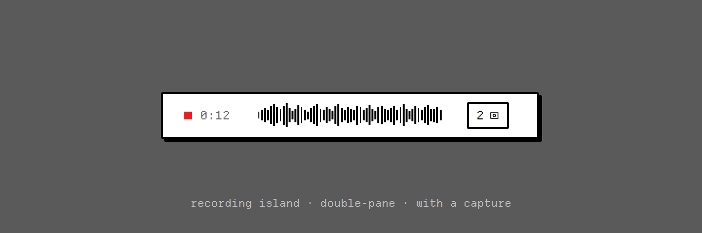
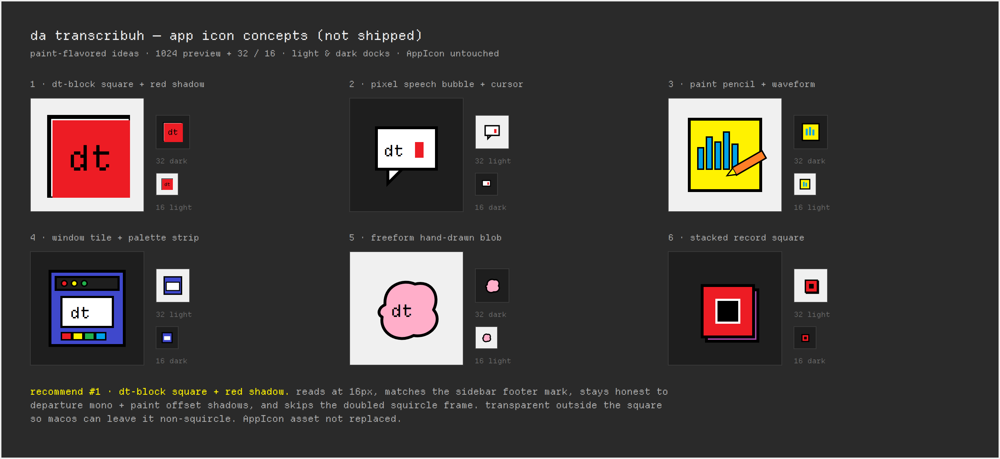

<p align="center">
  
</p>

<p align="center">
  
</p>

<p align="center">dictation in ur menu bar. grab the screen when u want the picture with the words.</p>

<p align="center">
  <a href="https://github.com/bicrick/da-transcribuh/releases/latest">download</a>
  ·
  <a href="#install">build from source</a>
  ·
  <a href="LICENSE">MIT</a>
  ·
  macOS 14+
</p>

<!-- TODO: drop a short demo gif at assets/demo.gif (talk, drag, paste) and embed it here when ready -->

## look

ms paint vibes — flat classic swatches, chunky 1–2px outlines, hard offset shadows, and manila **folder tabs** across the top of settings (no toolbox sidebar). departure mono for every “da transcribuh” wordmark and chrome label (lowercase, block cursor only after the h — never italic). sf mono for longer copy. custom thin scrollers. chrome keeps decorative palette strips out of the title bar and status bar.

appearance is system / light / dark from **general**, or mash `theme: …` in the menu bar to cycle. light stays white; dark is soft graphite (window `#2C2C2E`, raised `#353538`, front `#3A3A3D`, hairline `#4A4A4E`, text `#F2F2F2` / `#A8A8AD`, bevel `#F2F2F2` theme-inverted) — never midnight black. paint accents stay vivid.

the start/stop chord lives in **general** as paint keycaps — click, press a combo (modifier required, or a function key), it rebinds live. reset drops you back on ⌃⌥Space. home, the status bar, the menu panel, and onboarding all read the same stored shortcut.

the recording island stays minimal and symmetric: paint-red record square + fixed-width timer on the left, cyan waveform, screenshot-count chip on the right when you’ve grabbed a tile (the chip slot fully collapses when there are none). default size is the everyday footprint; compact is the same layout, tighter. same double-pane hard offset as selected chrome (`Ink.bevel` block down-right) — no palette strip, no extra chrome.

the app mark is Departure Mono **d** + inverted **t** block inside a square with a hard-offset bevel. light keeps the white plate; dark inverts to a graphite tile with a light border / “d” and a light “t” block (bevel inverts to `#F2F2F2` with the theme). keycaps / tip tiles / secondary chrome follow graphite invert; **Start** stays high-contrast (black in light, light fill in dark) with the red bevel. folder tabs are square 2pt accent outlines (no bevel). regenerate AppIcon (always the light plate) with `scripts/render_dt_icon.py`.

<p align="center">
  
</p>

<p align="center"><em>settings home · light mode (readme always shows the white look). charcoal dark lives in the app — see <a href="assets/brand/screenshots/settings-home-dark.png">settings-home-dark</a> if you want a peek.</em></p>

<p align="center">
  
</p>

<p align="center"><em>recording island · double-pane · with a capture</em></p>

<p align="center">
  
</p>

<p align="center"><em>icon concepts · <strong>chosen:</strong> d + inverted-t on white square + black bevel (ships as AppIcon)</em></p>

## install

download the [latest beta dmg](https://github.com/bicrick/da-transcribuh/releases/download/v0.9.0-beta.2/Mutter.dmg), open it, drag it to applications. done.

<!-- TODO: rename the release asset to da-transcribuh.dmg on the next cut; the current file is still Mutter.dmg -->

from source:

```sh
git clone https://github.com/bicrick/da-transcribuh.git
cd da-transcribuh
open PromptAnnotator.xcodeproj
```

macos 14 or later. the first build fetches whisperkit.

## what it does

- lives in the menu bar. press the shortcut (yours, not stuck on ⌃⌥Space), talk, press it again. words land on the clipboard (and paste into the front app when that makes sense).
- hold **shift** and drag to grab a piece of the screen. release shift to keep the tile. stop the session and you get the picture with the words.
- sessions save under `~/Documents/PromptAnnotator/Sessions/` (folder name stays put so your history doesn’t vanish).
- on-device speech via whisperkit. bring your own core ml folder or hugging face variant if you want. optional openai-compatible server for the final transcript only.
- settings window with folder-tab navigation, ⌘K command-palette search, status bar, paint keycap shortcut recorder in general, and the appearance switcher (or `theme: …` in the menu bar). models page for downloads and byom.

## shortcuts

| | |
| --- | --- |
| start / stop | ⌃⌥Space by default — click the paint keycaps in **general** to rebind (needs a modifier, or a function key). re-registers live. |
| mark / capture | hold shift, drag, release |
| paste image + text | control-option-v |
| cancel take | optional; set one in general (escape clears it while listening) |

## permissions

needs three switches. after you flip them, reopen the app so they stick.

- **microphone** — hears you
- **screen recording** — grabs the tiles you drag
- **accessibility** — watches the shortcut and shift

## models

open **models** in the settings window.

- **on this mac (whisperkit)** — built-in english models (fast / balanced / highest). balanced is the default. download once; it stays on disk.
- **your models** — add a local whisperkit core ml folder, or pull another hugging face variant.
- **openai-compatible server** — optional. final transcript only via `/v1/audio/transcriptions`. live captions stay off. api key lives in the keychain.

more detail: [`docs/BRING_YOUR_OWN_MODEL.md`](docs/BRING_YOUR_OWN_MODEL.md).

## paste behavior

when you stop a session, da transcribuh stages the sheet and the transcript. if a text field is focused, it pastes for you. if not, it leaves everything on the pasteboard and the menu bar says it’s ready — hit ⌃⌥V or ⌘V wherever you’re typing.

cancel drops the take. nothing gets staged.

## troubleshooting

- **no speech detected** — quiet rooms do that on purpose. say a sentence next time.
- **permissions look on but nothing works** — turn the switch off and on, then reopen.
- **model missing** — open models and download balanced (or whatever you picked).
- **paste missed the field** — check the menu bar for the ready-to-paste hint, focus a text field, then ⌃⌥V.
- **updates** — general → check. releases live at [github.com/bicrick/da-transcribuh/releases](https://github.com/bicrick/da-transcribuh/releases).

## brand bits

final **dt block** art lives in [`assets/brand/`](assets/brand/):

- `wordmark-g-dt-block.png` — lowercase “da transcribuh” plus a separate block cursor after the h (readme embeds this light mark; `wordmark-g-dt-block-dark.png` is available for dark surfaces)
- `icon-g-dt-block-1024.png` — app mark
- `readme-banner.png` — hero (paint traffic lights on the session window mock)
- `social-preview.png` (1280×640) — repo social preview; also mirrored as `social-preview-1280x640.png` / `@2x`
- `screenshots/settings-home-light.png` — settings home mock embedded in the readme (dark twin: `settings-home-dark.png`)
- `mocks/home-paint-light.png` — Paint-direction lock mock (dark twin: `home-paint-dark.png`)
- `mocks/recording-paint-light.png` — recording island default size with a capture (dark twin: `recording-paint-dark.png`; empty: `recording-paint-empty-{light,dark}.png`)
- `mocks/icon-concepts.png` — app icon explorations; chosen mark is d + inverted-t / white square / black bevel (also AppIcon)
- `menubar-g-dt-block-16.png` / `menubar-g-dt-block-32.png` — template menu-bar glyph

patrick: upload `assets/brand/social-preview.png` under the repo’s **settings → general → social preview** at launch (repo stays private until then). that part isn’t settable from here.

## license

[MIT](LICENSE). free and open source. be kind.
