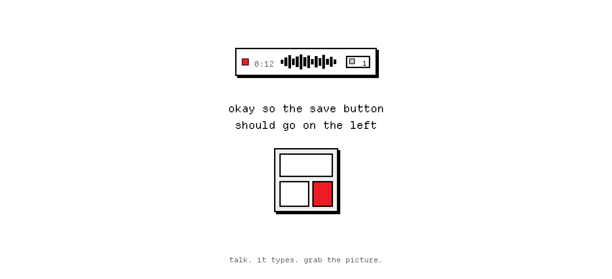

<p align="center">
  
</p>

<p align="center">free, fast, on-device voice to text in ur menu bar.</p>

<p align="center">
  <a href="https://github.com/bicrick/da-transcribuh/releases/latest">download</a>
  ·
  <a href="#install">build from source</a>
  ·
  <a href="LICENSE">MIT</a>
  ·
  macOS 14+
</p>

<p align="center">
  
</p>

<p align="center">if u like that, u'd probably like grabbing screens while u talk. drop a few tiles so u can point at multiple nits in one go.</p>

<p align="center">clipboard history is coming soon (⌘⇧C).</p>

## install

download [da-transcribuh.dmg](https://github.com/bicrick/da-transcribuh/releases/latest), open it, drag to applications. done.

```sh
git clone https://github.com/bicrick/da-transcribuh.git
cd da-transcribuh
open PromptAnnotator.xcodeproj
```

macOS 14 or later. the first build fetches WhisperKit.
