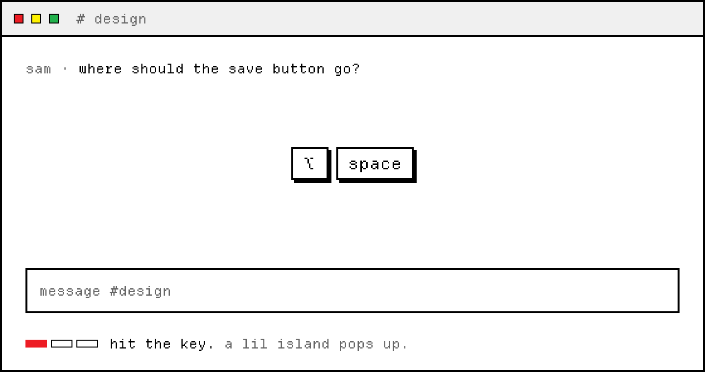
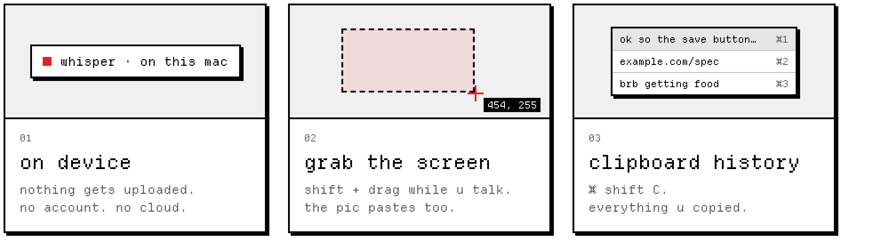

<p align="center">
  <picture>
    <source media="(prefers-color-scheme: dark)" srcset="docs/readme/header-dark.png">
    
  </picture>
</p>

<p align="center">
  point at stuff and yap.<br>
  free, on-device dictation in ur mac menu bar.
</p>

<p align="center">
  <a href="https://da-transcribuh-site.vercel.app/download"><b>download</b></a>
  &nbsp;·&nbsp;
  <a href="https://da-transcribuh-site.vercel.app">site</a>
  &nbsp;·&nbsp;
  macOS 14+
  &nbsp;·&nbsp;
  <a href="LICENSE">MIT</a>
</p>

<p align="center">
  <picture>
    <source media="(prefers-color-scheme: dark)" srcset="docs/readme/demo-dark.gif">
    
  </picture>
</p>

1. hit the key. a lil island pops up
2. say stuff. words show up live
3. hit it again. it pastes where ur cursor is

<p align="center">
  <picture>
    <source media="(prefers-color-scheme: dark)" srcset="docs/readme/features-dark.png">
    
  </picture>
</p>

## install

grab the dmg from the [download page](https://da-transcribuh-site.vercel.app/download), drag it into applications, open it.
needs macOS 14 or newer.

it'll ask for a few permissions:

- **microphone**: to hear u
- **accessibility**: to paste where ur cursor is
- **screen recording**: only for screen grabs

default model is `small.en`. u can swap to `tiny.en`, **Highest** (NVIDIA Parakeet TDT 0.6B v2 via [FluidAudio](https://github.com/FluidInference/FluidAudio), Apple Silicon), or [bring ur own](docs/BRING_YOUR_OWN_MODEL.md).

## build from source

needs Xcode 16+. the first build pulls WhisperKit, FluidAudio, and Sparkle through swift package manager.

```sh
git clone https://github.com/bicrick/da-transcribuh.git
cd da-transcribuh
xcodebuild -project PromptAnnotator.xcodeproj -scheme PromptAnnotator \
  -configuration Debug -derivedDataPath build \
  CODE_SIGN_IDENTITY=- build
open "build/Build/Products/Debug/da transcribuh.app"
```

`CODE_SIGN_IDENTITY=-` ad-hoc signs it so u don't need my cert. in Xcode, set signing to "sign to run locally".
heads up: macOS may ask for permissions again after each rebuild.

more in [CONTRIBUTING.md](CONTRIBUTING.md).

## privacy

transcription runs on ur mac with [WhisperKit](https://github.com/argmaxinc/WhisperKit) (Fast / Balanced) or [FluidAudio](https://github.com/FluidInference/FluidAudio) Parakeet (Highest). no account, no cloud, nothing gets uploaded.

it only touches the network to download a model, check for updates, or talk to ur own server if u [set one up](docs/BRING_YOUR_OWN_MODEL.md).

## license

[MIT](LICENSE). the font is [Departure Mono](https://departuremono.com) (SIL OFL).

### acknowledgements

- [WhisperKit](https://github.com/argmaxinc/WhisperKit) (Argmax) — Fast / Balanced on-device ASR.
- [FluidAudio](https://github.com/FluidInference/FluidAudio) (Apache-2.0) — Parakeet Core ML runtime for Highest.
- [NVIDIA Parakeet TDT 0.6B v2](https://huggingface.co/FluidInference/parakeet-tdt-0.6b-v2-coreml) weights — CC-BY-4.0. Highest uses the FluidInference Core ML conversion of NVIDIA’s English Parakeet model; attribution required by that license.
- Parakeet (Highest) needs **Apple Silicon**. Intel Macs keep Fast / Balanced (WhisperKit).
