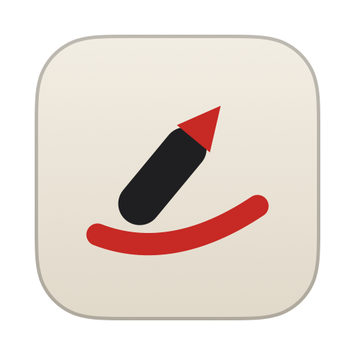
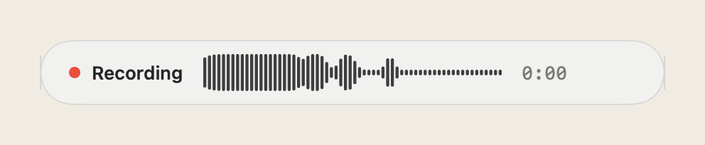
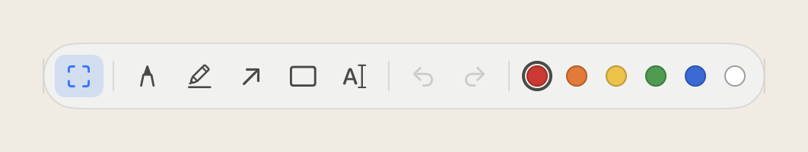
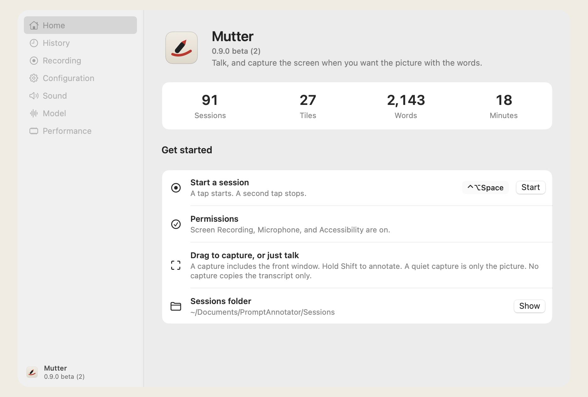

<p align="center">
  
</p>

<h1 align="center">Mutter</h1>

<p align="center">Talk, and capture the screen when you want the picture with the words.</p>

<p align="center">Open source, <a href="LICENSE">MIT</a>.</p>

<p align="center">
  
</p>

<p align="center">
  
</p>

<p align="center">
  
</p>

## Install

Download [Mutter.dmg](https://github.com/bicrick/mutter/releases/download/v0.9.0-beta.2/Mutter.dmg), open it, and drag Mutter to Applications.

To build from source:

```sh
git clone https://github.com/bicrick/mutter.git
cd mutter
open PromptAnnotator.xcodeproj
```

macOS 14 or later. The first build fetches WhisperKit.

## Shortcuts

| | |
| --- | --- |
| Start and stop | Control-Option-Space |
| Mark | Hold Shift |
| Capture | Release Shift |
| Clipboard | Stop puts the sheet and the transcript on the clipboard |

Sessions are saved in `~/Documents/PromptAnnotator/Sessions/`.

Screen Recording, Microphone, and Accessibility.
